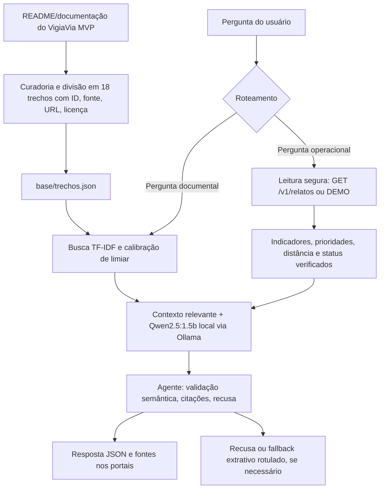

# 🛣️ VigiaVia GenAI — Global Solution FIAP 2026.2

**Disciplina:** Generative AI for Engineering  
**Versão avaliada:** V4.6 · **Modelo local:** `qwen2.5:1.5b` via Ollama  
**Projeto de origem:** [VigiaVia MVP](https://github.com/akiramrt/vigiavia-mvp)
 
> **Vídeo de demonstração:** [INSERIR LINK DO VÍDEO DEMONSTRATIVO]  
> **Relatório PDF:** `relatorio/Relatorio_Final_VigiaVia_GenAI_FIAP.pdf`

## 01 — Integrantes

| Nome completo | RM |
|---|---:|
| Deivison Pertel | 550803 |
| Eduardo Akira Murata | 98713 |
| Wesley Souza de Oliveira | 97874 |

## 02 — Ficha técnica: problema e solução de IA

**Problema:** Buracos nas vias geram riscos de mobilidade; chamados manuais podem ser lentos, duplicados e difíceis de priorizar ou interpretar. O MVP VigiaVia utiliza detecção visual para produzir relatos georreferenciados. Sua extensão **VigiaVia GenAI** busca responder perguntas documentais e explicar dados dos relatos de forma rastreável.

**Público:** cidadãos (pedestres, ciclistas, motociclistas, motoristas e usuários de transporte coletivo) e equipes de zeladoria.

**Solução:** dois portais web, API FastAPI, recuperação TF-IDF de documentos, agente de consulta/validação, LLM local Qwen2.5:1.5B via Ollama, retorno JSON com fontes e justificativa, verificação de números, IDs, status, evidências e recusa segura. Integração com a fila do MVP por **GET `/v1/relatos`**; modo DEMO contém **nove relatos simulados explicitamente rotulados**.

**Delimitação:** a extensão não treina YOLO, não faz fine-tuning LoRA, não repara vias, não cria chamados automaticamente e não altera status. A especialização escolhida é **agente com ferramentas/verificação**, comparado com baseline e RAG simples. As recomendações dependem de supervisão humana. O YOLO26n e o resultado mAP@0,5 = 0,585 pertencem ao MVP original e **não medem a LLM**.

## 03 — Diagrama do pipeline de IA e documentos



**Dados e documentos:** a base documental é derivada das seções citadas do README do MVP. O RDD2022 é a fonte de treinamento do detector visual do MVP, não um documento da base RAG. Em `live`, o GenAI consulta a API configurada em modo somente leitura; em `demo`, utiliza `dados/relatos_demo.json`.

## 04 — Tabela da base de conhecimento

A tabela representa **18 trechos em `base/trechos.json`**; o formato de origem é Markdown (README do projeto), e os trechos usados no RAG estão em JSON. A licença abaixo é a **declarada nos metadados da base**, não uma auditoria jurídica independente.

| Fonte documental | Formato de origem → RAG | Licença declarada | Nº de trechos | IDs |
|---|---|---|---:|---|
| [README VigiaVia — ficha técnica](https://github.com/akiramrt/vigiavia-mvp#ficha-t%C3%A9cnica-do-mvp) | Markdown → JSON | AGPL-3.0 (README do projeto) | 8 | V01, V02, V03, V05, V06, V07, V08, V18 |
| [README VigiaVia — arquitetura](https://github.com/akiramrt/vigiavia-mvp#arquitetura) | Markdown → JSON | AGPL-3.0 (README do projeto) | 4 | V04, V12, V13, V14 |
| [README VigiaVia — segurança e LGPD](https://github.com/akiramrt/vigiavia-mvp#seguran%C3%A7a-e-lgpd-resumo) | Markdown → JSON | AGPL-3.0 (README do projeto) | 3 | V09, V10, V11 |
| [README VigiaVia — como executar](https://github.com/akiramrt/vigiavia-mvp#como-executar) | Markdown → JSON | AGPL-3.0 (README do projeto) | 1 | V15 |
| [README VigiaVia — custos](https://github.com/akiramrt/vigiavia-mvp#custos-pre%C3%A7os-reais-brazil-south) | Markdown → JSON | AGPL-3.0 (README do projeto) | 1 | V16 |
| [README VigiaVia — licença](https://github.com/akiramrt/vigiavia-mvp#licen%C3%A7a) | Markdown → JSON | AGPL-3.0 (README do projeto) | 1 | V17 |

**Total: 18 trechos.** Cada entrada contém `id`, `titulo`, `fonte`, `url`, `licenca` e `texto`. Consulta também a `avaliacao/casos.json` (13 questões respondíveis e 5 de recusa).

## 05 — Performance do modelo: configurações testadas

**Última execução real da V4.6 (11/11/2026), Ollama Qwen2.5:1.5B local.** Acertos com revisão do núcleo do gabarito; a métrica de acerto **não** é a mesma que recusa ou citação automática.

| Configuração | Acertos semânticos* | Recusas esperadas | Recusas indevidas | Respostas com fonte | Latência média |
|---|---:|---:|---:|---:|---:|
| Baseline sem documentos | 5/18 (27,8%) | 5/5 | 12 | 0 | 597 ms |
| RAG simples | 11/18 (61,1%) | 5/5 | 2 | 11 | 1.220 ms |
| Agente V4.6 | 13/18 (72,2%) | 5/5 | 5 | 8 | 1.298 ms |

*Revisão conservadora dos 18 casos, incluindo recusas corretas; resultados devem ser reproduzidos e revisados pelo grupo antes da publicação definitiva. O agente tem maior acerto nesta amostra, mas mais recusas indevidas que o RAG simples.*

**Recuperação:** com limiar TF-IDF 0,19, `recall@1 = 7/13 (53,85%)` e `recall@3 = 7/13 (53,85%)`. Na calibração 0,16, ambos chegaram a `12/13 (92,31%)`, com menor seletividade de evidências. Os cinco casos “não consta” também são avaliados.

**Portais (DEMO):** 5/5 casos atendidos no Cidadão e 5/5 na Zeladoria, considerando respostas corretas e recusas seguras; **não** são dados de produção. `Z03` teve saída real `A consulta contém 9 relato(s).`, com `gerada_por_llm: true` e fonte `FILA`.

**Fontes para reproduzir:** `avaliacao/placar_real.json`, `avaliacao/rodada_portais_real.json`, `avaliacao/resultados_busca.json`, `avaliacao/calibracao_limires.json` e registros de rodadas anteriores em `avaliacao/rodada_*`. Os dois JSONs reais da V4.6 estão incluídos neste pacote documentado.

## 06 — Cinco erros reais, causas e correções propostas

| Caso real | Falha constatada | Causa provável / evidência | Correção implementada ou proposta |
|---|---|---|---|
| T03 (rodadas iniciais) | Explicou dados de origem em vez do fluxo de detecção e envio. | Recuperação da fonte V05 em lugar da V03; pergunta composta. | Roteamento temático e fonte decisiva V03; reavaliar. |
| T05 (rodadas iniciais/V4.6) | Apenas link ou recusa em vez de listar RDD2022, relatos e DEMO. | Resposta incompleta, mesmo com documentação acessível. | Validação por partes do gabarito e prompt focado em fontes V05. |
| T09 (rodadas iniciais) | Resposta omitiu prazo dos logs ou recusou. | Exigência de múltiplos fatos; insuficiência da geração/seleção. | Selecionar V09 e validar 'imagens não armazenadas' **e** '30 dias'. |
| T10 (V4.4/V4.6) | Afirmou login obrigatório ou recusou após detectar contradição. | Problema de negação e resposta contraditória ao documento V10. | Verificação de polaridade, rejeição da afirmação errada e resposta extrativa rotulada se necessário. |
| T11 (rodadas iniciais/V4.6) | Negou transferência internacional ou recusou resposta completa. | Negação alucinada ou resposta parcial sobre Nominatim. | Isolar V11; exigir explicação do envio do texto ao Nominatim fora do Brasil e alternativas mapa/GPS. |

**Observação:** há erros de recusa também em T01 e T13 na V4.6, registrados como limitações remanescentes. Os testes `pytest` verificam o código e os fluxos, não substituem avaliação factual do Ollama.

## 07 — Conclusão técnica e links

O agente com Qwen2.5:1.5B, recuperação documental e verificações de fontes atingiu **13/18 (72,2%)** na amostra acadêmica, acima de baseline (5/18) e RAG simples (11/18). A arquitetura permite usar um modelo local e separar dados verificados, conteúdo de LLM, recusa e fallback. Entretanto, a V4.6 ainda apresenta cinco recusas indevidas documentais e não deve ser apresentada como serviço pronto para produção. Uma avaliação independente mais ampla e autenticação apropriada são necessárias antes de uso institucional.

- **Repositório do MVP original:** https://github.com/akiramrt/vigiavia-mvp
- **Repositório da extensão GenAI:** [INSERIR LINK DO REPOSITÓRIO GENAI]
- **Vídeo demonstrativo:** [INSERIR LINK DO VÍDEO DEMONSTRATIVO]

## Reprodução local (Windows PowerShell)

Requisitos: Python 3.11; Ollama instalado; modelo `qwen2.5:1.5b`.

```powershell
py -3.11 -m venv .venv
.\.venv\Scripts\python.exe -m pip install -r requirements-dev.txt
ollama pull qwen2.5:1.5b
.\.venv\Scripts\python.exe -m uvicorn app.main:app --reload --port 8001
```

Interface: http://127.0.0.1:8001 | Swagger: http://127.0.0.1:8001/docs

Para apontar a extensão à API do MVP local, configurar `VIGIAVIA_API_URL=http://127.0.0.1:8000` e `ALLOW_HTTP_LOCAL=true` (apenas ambiente local).

```powershell
.\.venv\Scripts\python.exe -m pytest -q
.\.venv\Scripts\python.exe avaliacao/calibrar_limiar.py
.\.venv\Scripts\python.exe avaliacao/medir.py
.\.venv\Scripts\python.exe avaliacao/placar_llm.py
.\.venv\Scripts\python.exe avaliacao/rodada_portais_ollama.py
```

**Reprodutibilidade:** rodar `placar_llm.py` e `rodada_portais_ollama.py` sobrescreve os arquivos de saída da pasta `avaliacao/`. Preservar um backup antes da execução. As avaliações são amostrais e exigem revisão humana de conteúdo e alucinações.

## Organização principal

- `app/`: API, agentes, portais, recuperação e verificação semântica;
- `base/trechos.json`: base de 18 trechos documentais;
- `dados/relatos_demo.json`: nove relatos simulados;
- `avaliacao/`: casos, scripts, métricas e evidências de rodadas;
- `tests/`: testes automáticos;
- `relatorio/Relatorio_Final_VigiaVia_GenAI_FIAP.docx`: relatório final Word.
