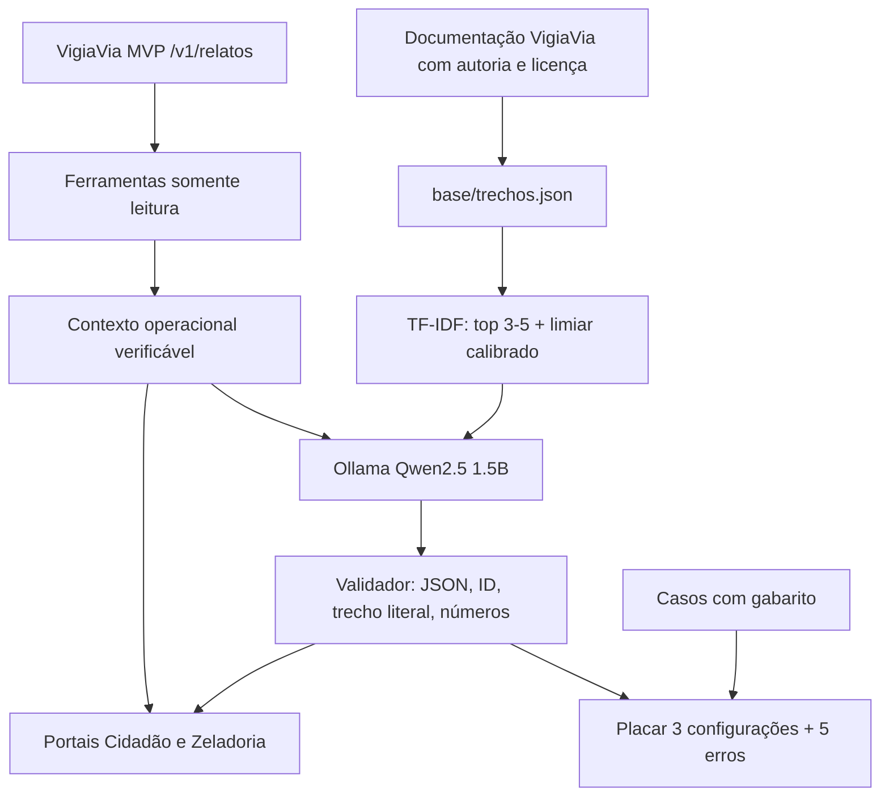

# VigiaVia — Relatório da Disciplina Generative AI for Engineering

**Global Solution FIAP CitizenTech, 2026.2 — mobilidade urbana**

**Integrantes:** Deivison Pertel — RM 550803; Eduardo Akira Murata — RM 98713; Wesley Souza de Oliveira — RM 97874.

**MVP:** https://github.com/akiramrt/vigiavia-mvp  
**Aplicação do MVP:** https://ca-vigiavia-prod.happywave-0bf5b4c3.brazilsouth.azurecontainerapps.io  
**Repositório público GenAI:** [ADICIONAR APÓS PUBLICAR]  
**Demonstração em vídeo:** [ADICIONAR APÓS GRAVAR]

## 1. Ficha técnica e problema que a IA resolve

| Campo | Descrição |
|---|---|
| Produto | VigiaVia — zeladoria inteligente de vias públicas + módulo VigiaVia GenAI |
| Público | Cidadãos que circulam por São Paulo e agentes de zeladoria; piloto Bela Vista |
| Problema | Buracos geram custos e riscos; relatos podem ser duplicados e são difíceis de interpretar e priorizar |
| Solução | Detector YOLO26n identifica buracos; GenAI **consulta e explica relatos, priorização, status e regras documentadas**, com fontes e recusa responsável |
| Arquitetura | MVP FastAPI+ONNX+Azure Container Apps; módulo GenAI FastAPI + Qwen2.5:1.5B local Ollama + RAG TF-IDF + agente com ferramentas de leitura |
| Dados | README/documentação com fontes; fila via GET /v1/relatos; dados simulados, expressamente identificados, para demonstração |
| Indicadores | recall@1, recall@3, qualidade semântica, citações válidas, recusas corretas, latência; indicadores operacionais da fila |
| ODS | 11.2, 11.3, 9.1, 3.6 |

**O que a IA faz no portal do cidadão:** consultas de ocorrências próximas, explicação de status, orientações e respostas sobre privacidade e registro. **Na zeladoria:** explicação da ordem de prioridade, triagem individual, contexto de possíveis duplicidades e indicadores da fila. O modelo não cria chamado nem altera status. Decisões operacionais seguem sendo humanas.

## 2. Pipeline

**Especialização:** agentes e ferramentas (sem LoRA). O modelo local não teve seus pesos ajustados; a atividade admite **LoRA ou agente** como componente especializado. A comparação é: baseline sem contexto, RAG simples e agente com verificação.

## 3. Base de conhecimento

| Origem | Formato | Licença | N.º trechos |
|---|---|---|---:|
| README do VigiaVia | Markdown estruturado em JSON | AGPL-3.0 (repositório original) | 18 |
| GET /v1/relatos | JSON operacional, sem imagens | Dados do próprio MVP; consultar termos do projeto | Variável por consulta; **não somado aos 18 chunks documentais** |
| `dados/relatos_demo.json` | JSON simulado | Conteúdo de demonstração do projeto | 9 ocorrências simuladas, não documentos |

Trechos com `id`, `titulo`, `texto`, `fonte`, `url` e `licenca` em `base/trechos.json`. A IA não deve misturar indicadores da amostra demo com o funcionamento real da cidade.

## 4. Busca e limiar

**Rodada 01 (executada):** limiar 0,19, recall@1 e recall@3 pós-limiar de 53,85%. No corpus estudado, limiar 0,16 aumentaria recall@1 para 92,31%, porém apenas 2/5 perguntas sem resposta seriam recusadas exclusivamente pelo limiar. Portanto, a melhoria de recall deve ser acompanhada por **validação posterior da resposta**, e não interpretada como precisão. A calibração pode ser reproduzida em `avaliacao/calibrar_limiar.py`. Evitar usar este mesmo conjunto tanto para calibrar e anunciar generalização: o conjunto de 10 casos operacionais é adicional e serve como verificação separada.

## 5. Geração fundamentada e LGPD

A resposta contém JSON, fontes, recusa, justificativa e evidência literal. O agente verifica a existência das fontes, a presença da passagem literal e ausência de novos números, mas **isso não comprova fidelidade semântica completa** (vide T10/T11). Os dados operacionais verificados são exibidos separadamente do texto da IA. Não armazenamos imagens e não solicitamos dados pessoais; a localização é usada na consulta sem precisar ser enviada ao Ollama. A fila real é lida por API configurada no servidor, não por URL enviada pelo navegador. O MVP original ainda possui a limitação de autenticação na fila; esta extensão não deve ser usada para decisões públicas sem autenticação e auditoria.

## 6. Placar das três configurações

| Métrica da rodada 01 | Baseline | RAG | Agente |
|---|---:|---:|---:|
| Correção semântica estrita / 18 | 5 | 7 | 8 |
| Respostas factuais corretas / 13 | 0 | 2 | 3 |
| Recusas corretas / 5 | 5 | 5 | 5 |
| Recusas indevidas | 11 | 7 | 6 |

**Interpretação:** agente supera baseline, mas ainda tem erros críticos. Os números acima são **anteriores à V4**, não são uma avaliação do código novo. `avaliacao/rodada_01_original/` contém o registro integral. A rodada V4 com Ollama deve ser gerada, revisada e adicionada aqui antes da entrega.

## 7. Cinco erros reais

Ver `avaliacao/relatorio_rodada_01.md`: T03 erro de seleção da fonte, T05 resposta incompleta, T09 recusa pelo limiar, T10 contradição sobre login, T11 contradição sobre transferência internacional. Cada um tem causa e plano de correção.

## 8. Conclusão técnica e pendências

O componente GenAI oferece um caso real de mobilidade com dois perfis de usuário, integração por contrato e verificabilidade. A V4 melhora a estrutura de fontes e o suporte às decisões do cidadão e da zeladoria, porém **não há evidência de acurácia superior da V4 até executar e avaliar a nova rodada**. Pendências: gerar `rodada_portais_real.json`, conferir as saídas, salvar notebook executado, inserir prints/vídeo, publicar repositório e adicionar URL pública do módulo GenAI (a do MVP não publica automaticamente este serviço local).

## Adendo experimental V4.3 (a confirmar no Ollama real)

A V4.3 incorpora um agente que seleciona fontes por assunto, valida contradições e completude e faz uma nova tentativa de geração. O RAG simples e baseline foram preservados. Resultados reais da V4.2 estão arquivados em `avaliacao/rodada_02_v42_original/`. Não atribuir ganho de acurácia à V4.3 até executar `placar_llm.py` e concluir revisão humana dos casos. A especialização adotada é **agente com ferramentas/regras**, não LoRA.
